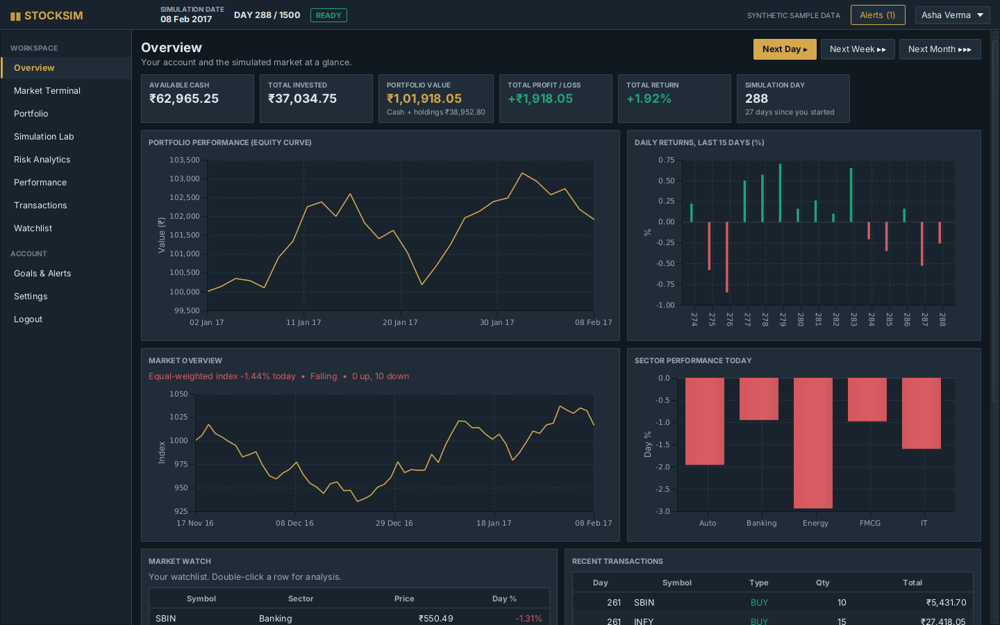
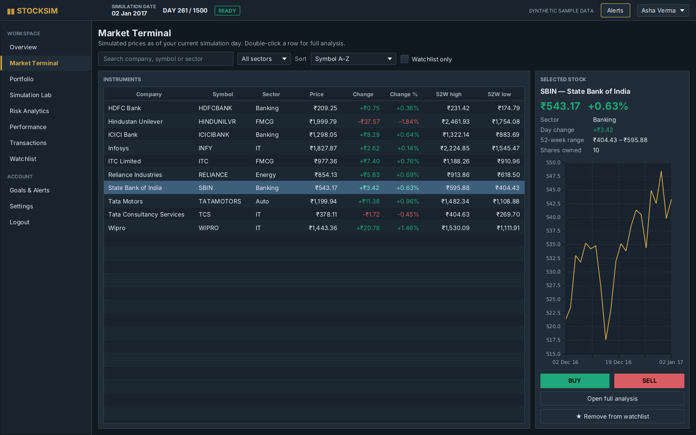
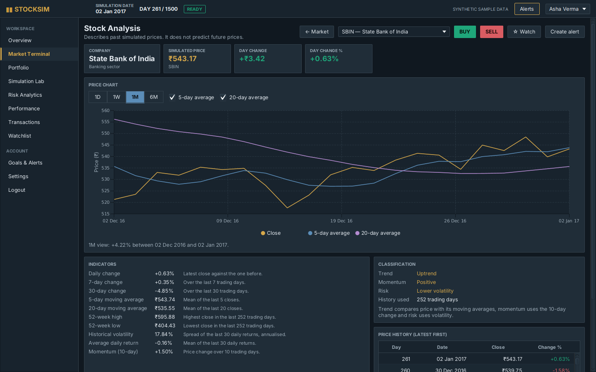
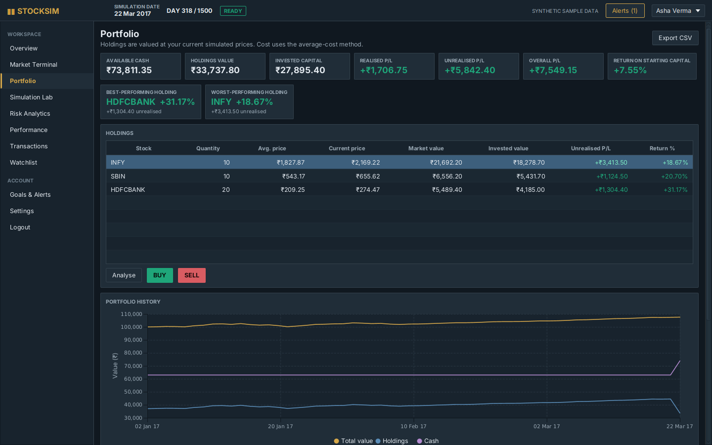
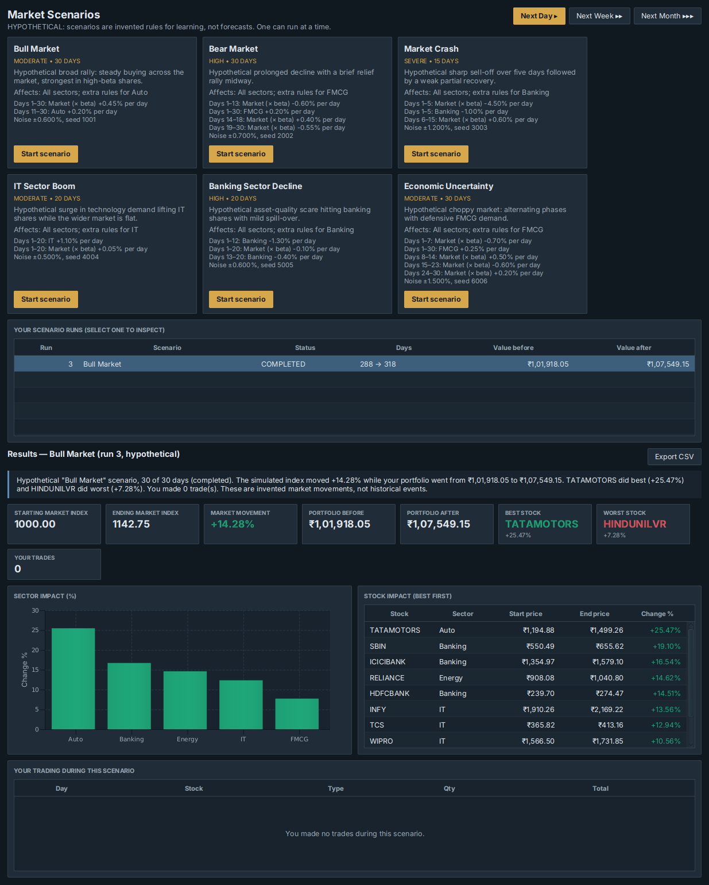
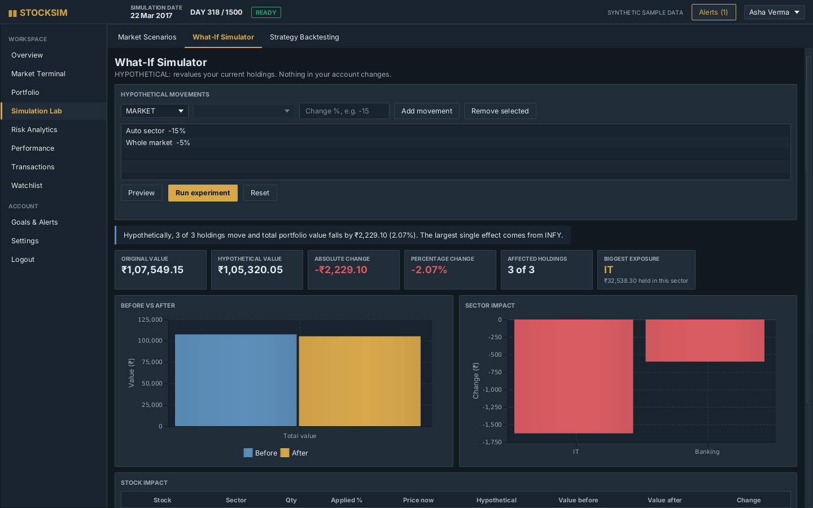
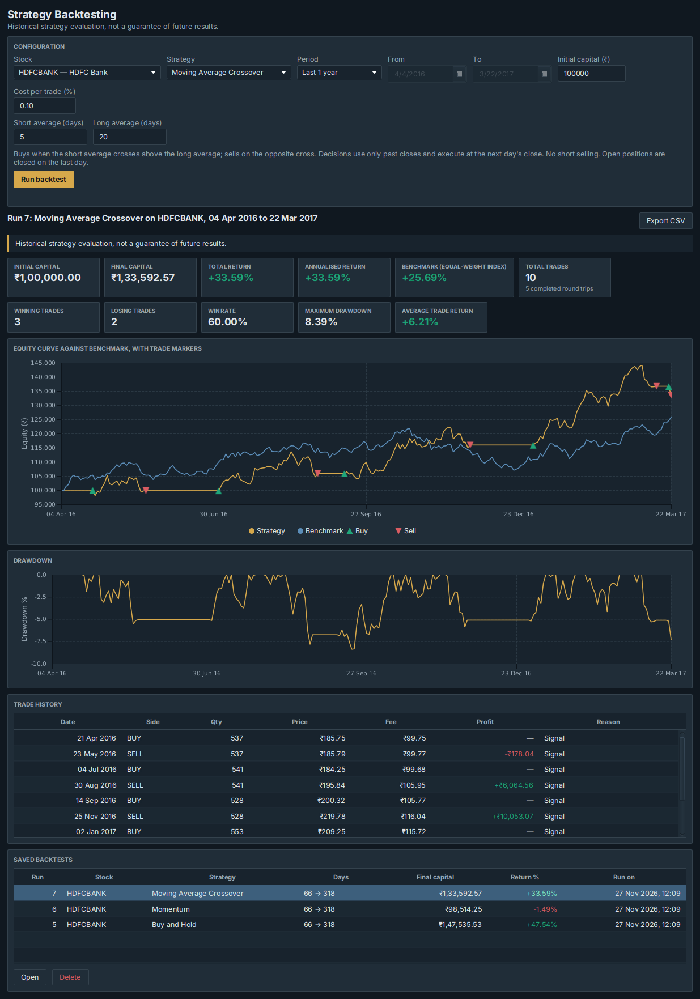
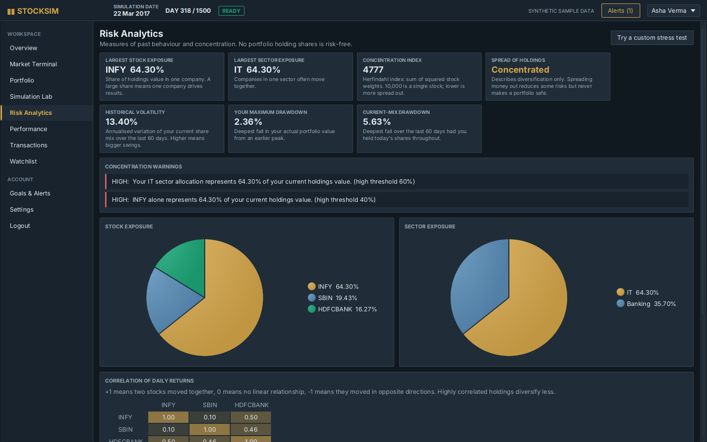
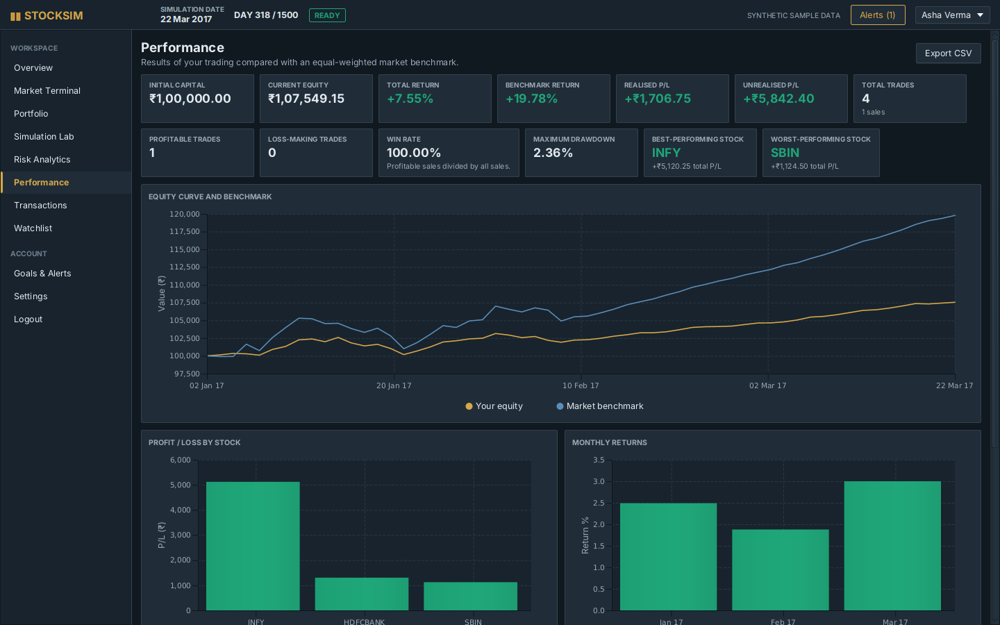

# StockSim

A desktop stock market simulator and portfolio analytics workspace built with
**Java, JavaFX (FXML + CSS), MySQL, JDBC, Maven and JUnit**. All money is virtual.
There is no live market data and nothing here is financial advice.



---

## 1. What it does

| Workspace | Features |
|---|---|
| Sign in | Registration, login by username or email, BCrypt password hashing, logout |
| Overview | Cash, invested, value, P/L, return, equity curve, daily returns, market index, sectors, watch list, trades, events, allocation |
| Market Terminal | Search, sector filter, sorting, watchlist toggle, detail panel, Buy / Sell |
| Stock Analysis | 1D / 1W / 1M / 6M chart, moving averages, ten indicators, trend, momentum and risk labels, price table |
| Portfolio | Holdings with average cost, realised and unrealised P/L, history, allocation, best and worst holding |
| Simulation Lab | Six market scenarios, what-if experiments, strategy backtesting |
| Risk Analytics | Concentration warnings, volatility, drawdown, correlation matrix, stress tests, explanations |
| Performance | Return, benchmark, win rate, drawdown, P/L by stock, monthly returns, allocation |
| Transactions | Filter, search, sort and inspect every trade |
| Watchlist, Goals & Alerts | Watched stocks, goals with progress bars, above/below price alerts |
| Settings | Trade confirmation, export folder, password change, snapshot, reset |

CSV export is available for portfolio, transactions, performance, backtests and
scenario results.

---

## 2. Setup

Requirements: JDK 17 or newer, MySQL 8.0+, and Maven 3.9+ (IntelliJ IDEA includes
Maven, so you do not need to install it separately if you run from the IDE).

### Windows

1. Install a JDK, for example in PowerShell:
   `winget install EclipseAdoptium.Temurin.21.JDK`
2. Install **MySQL Server 8** from <https://dev.mysql.com/downloads/>. Set a root
   password during configuration and keep it running as a Windows service
   (check in `services.msc`).
3. For the command line, download the Maven binary zip from
   <https://maven.apache.org/download.cgi>, extract it and add its `bin` folder to
   `Path`. Open a new terminal and check `mvn -version`; it should report Java 17
   or newer (set `JAVA_HOME` to the JDK folder if it does not).

### macOS

```bash
brew install openjdk maven mysql
brew services start mysql
```

### Configure the database password

No password is stored in the repository. In the project folder (next to `pom.xml`)
create `stocksim.local.properties`. On Windows: `notepad stocksim.local.properties`.

```properties
db.user=root
db.password=YOUR_MYSQL_PASSWORD
```

In this file write a backslash as `\\`, and use forward slashes in paths, for
example `csv.path=C:/Users/you/Downloads/stocks_df.csv`.

### Run

```bash
mvn clean compile
mvn javafx:run
```

In IntelliJ IDEA: open the folder as a Maven project, then in the Maven tool window
double-click **Plugins > javafx > javafx:run**.

On first launch StockSim creates the `stocksim` database and tables, then loads
prices. You do not need to run any SQL script by hand.

### Upgrading from the earlier StockSim database

The migrations only add tables and columns. Existing users, holdings and trades
are kept, and old password hashes are upgraded to BCrypt at the next login.
Back up first anyway:

```bash
mysqldump -u root -p --result-file=stocksim-backup.sql stocksim
```

On Windows, if `mysqldump` is not found, run it from MySQL's `bin` folder
(typically `C:\Program Files\MySQL\MySQL Server 8.0\bin`). Use `--result-file`
as shown; PowerShell's `>` can damage the dump's text encoding.

---

## 3. Price data

### Using real historical data (recommended)

1. Download **India Stock Market (daily updated)** by Larxel from
   <https://www.kaggle.com/datasets/andrewmvd/india-stock-market>
   (free Kaggle account; the listing shows a CC0 public domain licence).
2. Unzip it and copy `stocks_df.csv` into a folder named `data` inside the
   project, giving `data/stocks_df.csv`.
3. Start StockSim with an empty database. The top bar shows
   `IMPORTED HISTORICAL DATA`.

If you already started StockSim with sample data, prices are not replaced. Use a
new database by adding this to `stocksim.local.properties` (accounts in the old
database stay there):

```properties
db.url=jdbc:mysql://localhost:3306/stocksim_real?createDatabaseIfNotExist=true&useSSL=false&allowPublicKeyRetrieval=true&rewriteBatchedStatements=true
```

To keep the file elsewhere, set `csv.path`. Any file works if its columns are
`date,symbol,open,high,low,close,...`, with dates as `YYYY-MM-DD` and rows for
TCS, INFY, RELIANCE, HDFCBANK, ITC, WIPRO, ICICIBANK, TATAMOTORS, SBIN and
HINDUNILVR. Only dates shared by all ten are imported. The dataset is
historical: it is not live and ends on its last recorded date.

### Without a file

StockSim generates 1,500 trading days of **synthetic sample data** from a fixed
seed. It is not real price history, and the top bar says `SYNTHETIC SAMPLE DATA`.

---

## 4. Configuration

Defaults are in `src/main/resources/application.properties`. Later sources win:

1. `~/.stocksim/stocksim.properties`
2. `./stocksim.local.properties`
3. environment variables `STOCKSIM_DB_URL`, `STOCKSIM_DB_USER`,
   `STOCKSIM_DB_PASSWORD`, `STOCKSIM_CSV_PATH`
4. JVM system properties

| Key | Default | Meaning |
|---|---|---|
| `db.url`, `db.user`, `db.password` | local MySQL, `root`, blank | Connection |
| `csv.path` | blank (`data/stocks_df.csv` if present) | Historical price file |
| `sim.starting.balance` | 100000.00 | Capital for new accounts |
| `sim.start.day` | 261 | First day for new accounts, leaving history behind it |
| `risk.stock.elevated` / `high` | 25 / 40 | Stock concentration warnings (%) |
| `risk.sector.elevated` / `high` | 40 / 60 | Sector concentration warnings (%) |
| `export.dir` | `reports` | CSV folder (also changeable in Settings) |
| `snapshot.file` | `simulation_state.ser` | Snapshot file |

Logs are written to `logs/stocksim.log.0`. The text size is one value,
`-fx-font-size` under `.root` in `styles/main.css`; sizes are in `em`.

---

## 5. Database schema

Applied from `src/main/resources/db/migration/` and recorded in `schema_version`.

| Table | Contents |
|---|---|
| `users`, `user_settings` | Accounts, cash, starting capital, preferences |
| `stocks` | Ten companies with sector and beta |
| `stock_history` | Reference prices by simulation day (never modified) |
| `simulation_state`, `simulation_prices`, `simulation_events` | Each user's day, price path and events |
| `holdings`, `transactions`, `portfolio_snapshots` | Positions with cost basis, ledger, daily values |
| `watchlist`, `alerts`, `goals` | User lists and targets |
| `market_events` | Scripted fictional events |
| `market_scenarios`, `scenario_rules` | Scenario definitions |
| `scenario_runs`, `scenario_run_results` | Each user's scenario history |
| `backtest_runs`, `backtest_trades`, `backtest_results` | Saved backtests |
| `app_meta`, `schema_version` | Data source and applied migrations |

---

## 6. How the simulation works

* A week is 5 trading days and a month 21.
* Each user has a private price path. A normal day moves yesterday's price by the
  reference data's ratio plus any scripted event. A scenario day uses the
  scenario's market (scaled by beta) and sector rules plus seeded noise, so the
  same scenario is repeatable.
* Trades execute at today's simulated close using the average-cost method. Each
  trade is one database transaction with row locks.
* Backtests decide on day *t* and execute at the close of day *t+1*, so they
  cannot look ahead. They only use data up to your current day.

---

## 7. Project structure

```
src/main/java/com/stocksim/
  Main.java        application start-up
  model/           entities and records
  dao/             JDBC, PreparedStatement only
  service/         business rules and transactions
  simulation/      price movement
  backtesting/     strategies and engine
  analytics/       indicators, market index, what-if
  controller/      one controller per FXML screen
  ui/              charts, tables, dialogs, background tasks
  exception/ util/
src/main/resources/
  com/stocksim/fxml/   screens
  styles/main.css      terminal theme
  db/migration/        versioned SQL
  application.properties
src/test/java/com/stocksim/
docs/screenshots/
```

---

## 8. Tests

MySQL must be running. Tests drop and recreate **`stocksim_test`** and
**`stocksim_test_legacy`** (and `stocksim_test_import`) only. If your MySQL has a password, they read it from
`stocksim.local.properties`.

```bash
mvn test
```

| Suite | Covers |
|---|---|
| `CalculationTest` | Money, indicators, validation, strategies, what-if |
| `AccountAndTradingTest` | Registration, login, trades, rollback, user isolation |
| `SimulationTest` | Time, price paths, scenarios, alerts |
| `ModuleIntegrationTest` | Risk, performance, backtests, goals, exports, settings |
| `MigrationTest` | Upgrade of the earlier database layout |
| `DataImportTest` | CSV import, shared dates, missing stocks |
| `UiJourneyTest` | The real window, from registration through every workspace to logout and login |

`UiJourneyTest` opens a window (do not click in it) and saves screenshots to
`target/screenshots`. On Linux without a display it is skipped; use `xvfb-run mvn test`.

Last run (Linux, Java 21, MySQL 8.0.46): **47 tests, 0 failures, 0 errors** with a
virtual display; 46 without one.

---

## 9. Java concepts used (viva notes)

| Concept | Where to look |
|---|---|
| Abstraction, inheritance, polymorphism | `FinancialEntity` is abstract; subclasses implement `describe()` |
| Interfaces | `Calculable`, `Tradable`, `Strategy` with three implementations |
| Encapsulation | `Holding` keeps fields private and derives values |
| Records and enums | Immutable data such as `Transaction`; `TradeType`, `Page` |
| Generics and lambdas | `BaseDAO.query` with `RowMapper<T>`; `Database.Work<T, E>` |
| Collections and streams | Filtering in `MarketController`, grouping in the services |
| Checked and unchecked exceptions | `TradeException` and its subclasses; `ValidationException` |
| JDBC | `PreparedStatement`, try-with-resources, generated keys, batches |
| Transactions | `Database.transaction`, `SELECT ... FOR UPDATE`, rollback in `TradingService` |
| Layered design / DAO pattern | controller → service → DAO |
| Strategy pattern | `backtesting` package |
| Concurrency | `Async` runs a JavaFX `Task` on a worker thread and updates the UI on the FX thread |
| JavaFX | FXML, controllers, `TableView`, cell factories, bindings, charts, CSS |
| File I/O and serialization | CSV with `BufferedWriter`; snapshot with object streams and an input filter |
| Security | BCrypt, parameterised SQL, per-user queries, no secrets in Git |

---

## 10. Demonstration workflow

1. Create an account and note the ₹1,00,000 starting capital.
2. **Market Terminal:** search, pick a stock, add it to the watchlist, buy two or three stocks.
3. **Stock Analysis:** switch periods and explain the indicators.
4. **Goals & Alerts:** set a goal and a price alert close to the current price.
5. **Overview:** press Next Day, Next Week, Next Month.
6. **Portfolio:** sell part of a holding and show realised P/L.
7. **Simulation Lab:** run the Market Crash scenario to the end, then a what-if, then a moving-average backtest.
8. **Risk Analytics** and **Performance:** explain the concentration warnings and benchmark.
9. Export a CSV, log out, log in again and show that everything persisted.

---

## 11. Screenshots

| | |
|---|---|
|  |  |
|  |  |
|  |  |
|  |  |

---

## 12. Known limitations

* Verified on Linux with Java 21 and MySQL 8.0. It has not been run on Windows or macOS.
* Ten fixed stocks and daily closing prices only; the 1D view compares two closes.
* Manual trades have no fees, taxes, slippage, dividends or corporate actions.
* Backtests are single-stock, long-only, whole shares, with a percentage fee.
* Time moves forward only. Reset in Settings to start again.
* One scenario can run at a time per user.
* No connection pool: each operation opens its own connection, which suits a local database.
* No password recovery or login rate limiting.
* The Inter font is used if installed, otherwise a system font.
* Snapshots are read-only records and cannot restore an account.
# StockSim

